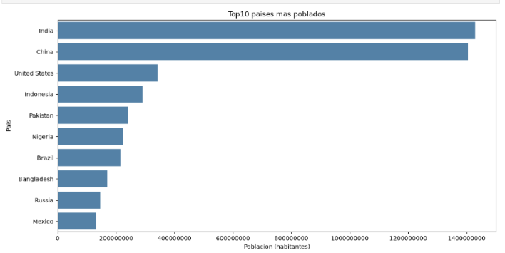

#  Web Scraping y Análisis de Población Mundial con Python

## Descripción del proyecto

Este proyecto realiza la extracción, limpieza, análisis y visualización de datos de población de países y territorios obtenidos de Wikipedia.

El objetivo es aplicar técnicas fundamentales de Ciencia de Datos utilizando Python, integrando web scraping, procesamiento de datos, visualización y consultas SQL.

## Tecnologías utilizadas

- **Python:** lenguaje de programación.
- **Requests:** solicitudes HTTP.
- **BeautifulSoup:** extracción de información HTML.
- **Pandas:** limpieza y análisis de datos.
- **Matplotlib y Seaborn:** visualización de información.
- **SQLite:** consultas SQL.
- **JupyterLab:** desarrollo del proyecto.

## Metodología

1. Conexión a Wikipedia mediante solicitudes HTTP.
2. Identificación y extracción de tablas HTML.
3. Conversión de los datos a un DataFrame.
4. Exploración de tipos de datos y valores faltantes.
5. Limpieza y organización de la información.
6. Visualización de los países más poblados.
7. Creación de una base de datos temporal SQLite.
8. Ejecución de consultas SQL y exportación a CSV.

## Resultados

- Se obtuvieron 239 registros después de la limpieza.
- Se identificaron los diez países más poblados según la fuente consultada.
- Se encontraron 16 países con poblaciones superiores a 100 millones de habitantes.
- Se generó una gráfica comparativa de población.
- Se realizaron consultas SQL sobre los datos procesados.

## Visualización de resultados

### Top 10 países más poblados

La siguiente gráfica presenta los diez países
con mayor población según los datos extraídos
de Wikipedia.

## Fuente de datos

Wikipedia: [List of countries and dependencies by population](https://en.wikipedia.org/wiki/List_of_countries_and_dependencies_by_population).

**Nota:** las cifras corresponden a estimaciones publicadas para diferentes fechas y pueden cambiar con las actualizaciones de Wikipedia.

## Ejecución

Abrir `Web_Scraping_Wikipedia.ipynb` en JupyterLab o Google Colab, instalar las dependencias necesarias y ejecutar las celdas en orden.

## Archivos

- `Web_Scraping_Wikipedia.ipynb`: código y análisis.
- `datos/poblacion_paises.csv`: datos procesados.
- `datos/paises_mas_100_millones.csv`: resultados de la consulta SQL.

## Conclusión

Este proyecto permite comprender un flujo básico de Ciencia de Datos, desde la obtención de información de una página web hasta su transformación, análisis y consulta mediante herramientas de Python y SQL.
